# Report material: AI-Powered Computer Engineering Student Advisor

Facts for the project report. Every number comes from a file in this repository, named in brackets after it. This file is not the report: it is the material to write it from. The state described is commit `3ce604b` plus the final evaluation of 2026-10-22/23.

## 1. System overview

- **What it is:** a retrieval-augmented generation (RAG) advisor for prospective and current Computer Engineering students, with a focus on OSTİM Technical University. [README.md]
- **Stack:**
  - Frontend: React + Vite.
  - Backend: FastAPI.
  - Vector database: ChromaDB, fused with BM25 keyword search.
  - Embeddings: `BAAI/bge-m3`.
  - Local LLM: `qwen2.5:3b` through Ollama. [README.md; backend/app/core/retrieval_config.py; backend/app/core/llm_config.py]
- **No cloud LLM APIs:** none are used for answer generation. [README.md]
- **Deployment:** Docker Compose runs three services: `ollama`, `backend` and `frontend` (nginx on port 8080). [docker-compose.yml; README.md]

### Architecture

```mermaid
flowchart LR
    U[Student browser<br/>React + Vite] -->|POST /api/v1/chat/stream| API[FastAPI chat API<br/>backend/app/api/chat.py]
    API --> QU[Query understanding<br/>help / out-of-scope / follow-up<br/>query_understanding.py]
    QU -->|follow-up| RW[Follow-up rewrite<br/>qwen2.5:3b, standalone question<br/>follow_up_rewriter.py]
    QU -->|help or out of scope| FIXED[Fixed help / scope reply]
    RW --> RET
    QU -->|domain question| RET[Hybrid retriever<br/>retriever.py]
    RET --> VEC[(ChromaDB<br/>2833 chunks<br/>bge-m3, 1024-d, cosine)]
    RET --> BM[BM25 over chunks.jsonl]
    VEC --> RRF[Reranking + reciprocal rank fusion<br/>top 5]
    BM --> RRF
    RRF --> GATE{Evidence gate<br/>similarity ≥ 0.50<br/>+ answerability guards}
    GATE -->|insufficient| REFUSE[Insufficient-information reply]
    GATE -->|sufficient| PROMPT[Grounded prompt<br/>labelled passages S1..S5]
    PROMPT --> LLM[qwen2.5:3b via Ollama]
    LLM --> CHECK[Citation + grounding checks<br/>lexical + semantic]
    CHECK -->|pass| ANSWER[Answer with source cards]
    CHECK -->|fail| FALLBACK[Verbatim extractive quote<br/>or refusal]
```

## 2. Knowledge base

### Sources

- **Registry:** 131 sources. 119 have a processed document and 109 are indexed. [knowledge_base/sources.json; knowledge_base/processed/processing_manifest.json; knowledge_base/chunks/chunks.jsonl]
- **Not indexed:**
  - 12 registry entries have no usable raw file (src_009–src_013, src_032, src_047, src_055, src_056, src_077, src_078, src_121).
  - 9 processed documents were excluded from chunking after review (src_019, src_021–src_024, src_027, src_046, src_122, src_124).
  - src_076 awaits manual review. [same files]
- **Curated notes:** 6 of the 109 indexed sources are curated verbatim excerpts of other sources (src_126–src_131, see §6). [docs/handwritten-removal-20261022/report.md]

**Indexed sources (109)** [knowledge_base/sources.json, filtered to source IDs in knowledge_base/chunks/chunks.jsonl]:

| Language | Sources |
|---|---:|
| English | 80 |
| Turkish | 29 |

| Category | Sources |
|---|---:|
| student_life | 18 |
| curriculum | 11 |
| skills_and_technologies | 11 |
| employment | 11 |
| department_information | 8 |
| internships | 6 |
| common_misconceptions | 6 |
| specializations | 5 |
| remote_work | 4 |
| graduate_studies | 4 |
| programming | 4 |
| artificial_intelligence | 4 |
| future_technologies | 3 |
| career_opportunities | 3 |
| work_life_balance | 3 |
| cybersecurity | 3 |
| mathematics | 2 |
| salaries | 2 |
| entrepreneurship | 1 |

**Publication year:**
- 2011: 2
- 2016: 1
- 2017: 1
- 2019: 2
- 2020: 5
- 2021: 2
- 2023: 1
- 2024: 17
- 2025: 17
- 2026: 13
- No date recorded: 48

**File type:** 61 HTML, 26 PDF, 22 plain text. [knowledge_base/processed/processing_manifest.json]

**Source types:** 59 distinct types. [knowledge_base/sources.json]
- The largest groups:
  - official university regulation documents: 15
  - official department pages: 6
  - professional career-organisation articles: 5
  - university academic-advising resources: 5
  - university career-centre resources: 4
  - official course syllabi: 4
  - professional curriculum reports: 4
- 23 indexed sources come from OSTİM Technical University, by title or publisher. [knowledge_base/sources.json]

### Data collection

- **How pages were fetched:** sources were approved one by one, then fetched only from their exact approved URL, with no crawling. Each file was named by source ID and logged in `knowledge_base/raw/acquisition_manifest.json`. [docs/content-acquisition-report.md; scripts/acquire_sources.py]
- **Blocked pages:** sources that blocked automatic download were saved manually from the same publisher only. No mirrors and no CAPTCHA or login bypass were used. [docs/manual-source-acquisition.md]
- **Growth of the source set:**
  - 56 approved sources at first collection (2026-08-30). [docs/content-acquisition-report.md]
  - Expanded to 94 sources on 2026-10-19 and to src_095–src_125 on 2026-10-19/20. [git history]
  - 6 curated notes added on 2026-10-22.
- **Recorded per source:** title, publisher, type, URL, publication date, access date, category, language and a reliability note. [knowledge_base/sources.json, metadata_schema]

### Preprocessing

- **HTML:** a conservative `html.parser` extractor. It drops script, style, nav, footer, form and SVG content and keeps headings, paragraphs, lists and tables. [docs/preprocessing-report.md; scripts/preprocess_sources.py]
- **PDF:** `pypdf`. [same]
- **Plain-text notes:** read as is. [same]
- **Normalisation:** each document is normalised and prefixed with its source ID and title. Quality warnings mark short or low-text documents for manual review. [scripts/preprocess_sources.py]

## 3. Chunking: old vs new and why

| | Before (until 2026-10-22) | Now (Step 1.2 option f) |
|---|---|---|
| Size (target / max / overlap, words) | 380 / 500 / 60 | 180 / 220 / 40 |
| Cleaning before chunking | none | source-id headers, "Page N" lines and cookie banners removed; for HTML, navigation blocks shared by ≥3 pages and repeated paragraphs removed (34 boilerplate patterns) |
| Chunks | 1132 from 75 documents | 2833 from 109 documents (2822 from 103 + 11 from the curated notes) |
| Mean chunk length | 399 words | 185 words |

[knowledge_base/chunks/chunking_manifest.json; git show 0172a2e~1:knowledge_base/chunks/chunking_manifest.json; docs/retrieval-paraphrases-step-1-2/summary.json]

**The truncation finding:** `all-MiniLM-L6-v2` reads at most 256 tokens. The old chunks averaged 644 tokens, so:
- 95.2% of chunks were cut off;
- 60.7% of all knowledge-base tokens were never embedded.

With 180-word chunks and bge-m3's 512-token window, 3.9% of chunks are cut and 1.8% of tokens are lost. [docs/retrieval-paraphrases-step-1-2/summary.json, `embedding.*.chunks_truncated_share` and `tokens_never_embedded_share`]

## 4. Embedding model choice (Step 1.2)

**Data:** 313 scored questions, from the 240 paraphrases and the 116 answerable unseen questions; 43 questions without labelled expected sources were skipped. 68 of them have Turkish expected sources and 115 have OSTİM-specific ones. [docs/retrieval-paraphrases-step-1-2/summary.json; scripts/evaluate_retrieval_paraphrases.py]

**Measures:**
- Recall@5: the share of expected sources that appear in the top 5.
- MRR@10.
- Hit@5: at least one expected source in the top 5.

| Option | R@5 all | MRR all | Hit@5 all | R@5 TR | Hit@5 TR | R@5 OSTİM | Hit@5 OSTİM | Chunks | s/query |
|---|---:|---:|---:|---:|---:|---:|---:|---:|---:|
| Baseline (old live index, MiniLM) | 0.406 | 0.504 | 0.636 | 0.269 | 0.500 | 0.388 | 0.661 | 1132 | 0.030 |
| Control: old chunking, all docs | 0.442 | 0.544 | 0.671 | 0.263 | 0.471 | 0.383 | 0.643 | 1264 | 0.028 |
| a: 180-word chunks + cleaning, MiniLM | 0.433 | 0.544 | 0.674 | 0.277 | 0.515 | 0.363 | 0.652 | 2822 | 0.034 |
| b: a + bge-small-en-v1.5 | 0.461 | 0.551 | 0.697 | 0.253 | 0.456 | 0.389 | 0.652 | 2822 | 0.047 |
| c: a + multilingual-e5-small | 0.397 | 0.484 | 0.613 | 0.252 | 0.456 | 0.347 | 0.548 | 2822 | 0.047 |
| d: b + BM25 (RRF) | 0.490 | 0.568 | 0.719 | 0.291 | 0.471 | 0.435 | 0.696 | 2822 | 0.057 |
| e: a + bge-m3 (512 tokens) | 0.473 | 0.542 | 0.728 | 0.379 | 0.618 | 0.456 | 0.713 | 2822 | 0.220 |
| **f: e + BM25 (RRF), chosen** | **0.514** | **0.578** | **0.760** | **0.445** | **0.691** | **0.504** | **0.791** | 2822 | 0.288 |

[docs/retrieval-paraphrases-step-1-2/summary.md]

**Why f over d.** The paired bootstrap over question clusters (95% interval) compares f with d:
- **Turkish-source questions:** Recall@5 +0.154 [+0.075, +0.263] and Hit@5 +0.221 [+0.102, +0.377].
- **OSTİM questions:** Recall@5 +0.070 [+0.007, +0.140].
- **Overall:** Recall@5 +0.024 [−0.014, +0.061], so not worse.
- **Speed:** 0.288 s/query, under the 0.5 s limit.

[docs/retrieval-paraphrases-step-1-2/summary.json, `paired_bootstrap_vs_reference.d` for overall; the Turkish and OSTİM intervals were computed with the same method and seed for the decision and are not saved in that file]

**Costs:**
- Embedding all chunks with bge-m3 took 3904 s on the laptop CPU.
- Peak process memory was 2.35 GB, with 2.31 GB of 15.7 GB system RAM still free at the lowest point.

[docs/retrieval-paraphrases-step-1-2/summary.json, `embedding.e`]

**Earlier choice:** MiniLM was chosen in Stage 11 for being light and CPU-friendly, when the corpus was English-only. [docs/embedding-model-selection.md] Turkish OSTİM sources added later made a multilingual model worth testing.

**Check after applying f:** the live retriever reproduces option f on 309 of 313 top-10 lists (Recall@5 0.513, Hit@5 0.760). [docs/retrieval-f-calibration/README.md]

## 5. Vector database and hybrid search

- **Vector store:** ChromaDB 1.5.9 with persistent collection `ceng_advisor_chunks`, cosine distance, 2833 records of 1024 dimensions. Metadata per chunk: source ID, title, publisher, type, URL, date, category, language and section. [knowledge_base/vector_store/vector_store_manifest.json]
- **Vector side of retrieval:**
  - The query is expanded with fixed topic hints for known phrasings.
  - 12 vector candidates are taken, plus 3 per preferred category.
  - Candidates are reranked with small boosts for category (+0.08), official source (+0.05) and title keyword (+0.02).

  [backend/app/rag/retriever.py; backend/app/core/retrieval_config.py]
- **BM25 side:**
  - `rank_bm25.BM25Okapi` over the same chunks.
  - Tokens are case- and diacritic-folded, so OSTİM, OSTIM and ostim match.
  - English stop-words are dropped.
  - The top 12 BM25 chunks are fused with the reranked vector list by reciprocal rank fusion (score = Σ 1/(60 + rank)).
  - At most 3 chunks per source in the top 5.

  [backend/app/rag/retriever.py: `_fuse_with_bm25`, `diversify_results`]
- **Evidence gate:** a question goes to the LLM only if the top chunk and at least 2 of the top 5 have cosine similarity ≥ 0.50.
  - The threshold was recalibrated for bge-m3: 96.8% of 528 in-scope test questions pass.
  - MiniLM's 0.30 would block nothing, because bge-m3 gives unrelated text a cosine score of about 0.4–0.55.

  [docs/retrieval-f-calibration/README.md; docs/retrieval-f-calibration/retrieval-threshold.json]

## 6. RAG pipeline and prompt

**Steps** [backend/app/rag/rag_pipeline.py: `RAGPipeline.answer`; backend/app/api/chat.py]:
1. **Query understanding** classifies the question as a domain question, contextual follow-up, source follow-up, vague question, help request, or out-of-scope/persona question. Help and out-of-scope get fixed replies without retrieval. [backend/app/query_understanding.py]
2. **Follow-up rewrite** (§8).
3. **Hybrid retrieval**, top 5.
4. **Evidence gate**, then four answerability guards: topic coverage, exact facts the knowledge base lacks (fees, guarantees, exact dates), category fit, and claim-type checks such as salary comparisons or AI-replacement claims. A failing question is refused before the LLM is called.
5. **Context:** labelled passages [S1]–[S5]. At most 700 characters per passage, focused on the sentences that share terms with the question, and at most 3000 characters in total (about 4 passages).
6. **Generation:** `qwen2.5:3b`, temperature 0.2, 4096-token context, at most 220 new tokens, model kept loaded for 2 h. [backend/app/core/llm_config.py; `RAG_NUM_PREDICT`]
7. **Citation and grounding checks** (§7). A failing answer gets one citation-retry prompt, then the verbatim extractive fallback or a refusal.

**Prompt rules** [backend/app/rag/rag_pipeline.py: `build_grounded_prompt`]:
- Use only the supplied context; no outside knowledge.
- Every factual statement must be directly stated by the cited passage, one checkable claim per sentence with its [S#] in the same sentence.
- Answer the exact question in the first sentence.
- Do not recommend a degree, learning order or career outcome without support.
- A sample course or a topic list is not proof of a program-wide total or a prerequisite.
- Answer only the supported part of a partly answerable question.
- Write exactly `INSUFFICIENT_INFORMATION` if nothing is supported.
- Conversation context may resolve references but is not evidence.

**No hand-written answers:**
- Until 2026-10-22 the pipeline injected six hand-written passages and used seven `bounded_*` answer templates (§11).
- All were removed. The only fallback left is `extractive_partial_answer`, which quotes one retrieved sentence verbatim. [docs/handwritten-removal-20261022/report.md]

## 7. Grounding checks

[backend/app/rag/rag_pipeline.py: `validate_citations`, `cited_claim_supported`, `unsupported_generated_answer_reason`; backend/app/core/retrieval_config.py]

- **Citations:** each answer sentence must cite valid labels from the supplied context. Uncited sentences are repaired only when a passage supports them; unknown labels fail validation.
- **Lexical support:** a cited sentence must share enough content words with its cited passage. Generation guards reject observed over-claims, for example a sample course's lab hours presented as a program total, an FPGA prerequisite that no source states, or a field-wide Linux requirement. [docs/grounding-improvement-report-20261016.md]
- **Semantic thresholds** (cosine with the retrieval model, bge-m3):
  - Question ↔ answer similarity ≥ 0.70 rescues the topic-term check.
  - Cited sentence ↔ best passage sentence ≥ 0.72 supports a cited sentence.
  - Both thresholds were recalibrated when moving from MiniLM (0.65 / 0.70). The rule was that bge-m3 accepts no more mismatched or known-unsupported pairs than MiniLM did; it accepts 139 of 202 correct claims against MiniLM's 110. [docs/retrieval-f-calibration/README.md; grounding-*.json there]
- **Why NLI is used only for evaluation:**
  - A manual review of 21 answers showed that word overlap lets misattributions and misreadings through. [docs/semantic-rescue-rerun-20261019/manual-review.md]
  - A claim-level NLI check (`cross-encoder/nli-deberta-v3-small`) was therefore tested against that review's sentence-level answer key.
  - As a filter at a 0.5 threshold, it would fix 10 of 11 flawed answers but damage 4 of 8 good answers by removing supported sentences. It takes about 0.77 s per sentence on the CPU. [docs/report/nli-answer-key-check.json; scripts/evaluate_nli_claims.py]
  - So it is kept as a measurement (§10), not a filter. [commit 2b5110b]

## 8. Follow-up handling

- **Rule-based resolver:** pronouns, "what about …", "which one" and similar are resolved with the previous question's topic, and 8 turns are kept per session. [backend/app/query_understanding.py: `resolve_follow_up_question`; backend/app/api/chat.py]
- **LLM rewrite (since 2026-10-22):** for a follow-up, or a domain question containing "it", "that", "those", "what about" or "the first one" after an earlier turn, `qwen2.5:3b` gets the last two turns. It is asked only for one standalone question (temperature 0, at most 60 tokens).
  - The rewrite drives retrieval.
  - Empty, invalid or repeated rewrites fall back to the rule-based question.
  - Both versions are logged in `retrieval_metadata.follow_up_rewrite`.

  [backend/app/services/follow_up_rewriter.py]
- **Effect on the 22 multi-turn test cases:** supported answers 9 → 12, wrong refusals 8 → 4, unsupported answers 4 → 5. The rewrite never fires on the 178 single-turn cases. [docs/follow-up-rewrite-20261022/report.md]

## 9. Evaluation results before the final changes

| Run | Supported | Correct refusal | Incorrect refusal | Unsupported | Mean s/answer | File |
|---|---:|---:|---:|---:|---:|---|
| 2026-10-13, after KB expansion (200 cases) | 1 (0.5%) | 34 (17.0%) | 55 (27.5%) | 106 (53.0%) | 63.24 | docs/full-200-ceng-ai-advisor-evaluation-after-kb-ollama-20261013-202801/report.md |
| 2026-10-18, after reliability fixes (193 of 200 cases) | 90 (46.6%) | 34 (17.6%) | 50 (25.9%) | 19 (9.8%) | 26.55 | docs/full-200-evaluation-20261018-reliability/report.md |

Labels come from an automated classifier: citation validity, expected-topic evidence and lexical claim support. They are not human verification. [docs/full-200-evaluation-20261018-reliability/report.md]

## 10. Final evaluation (2026-10-22/23)

All runs used the live system after every change in §11: option-f retrieval, no hand-written passages, the LLM follow-up rewrite on, and `qwen2.5:3b`. Raw answers and cited passages are saved in each results file. [docs/final-evaluation-20261023/run_final.py]

### 200-question set

| Label | Count |
|---|---:|
| Supported by evidence | 94 (47.0%) |
| Correct refusal (insufficient information) | 33 (16.5%) |
| Incorrect refusal (evidence exists) | 43 (21.5%) |
| Unsupported, incorrect or misleading | 30 (15.0%) |
| Runtime errors | 0 |

- Answered cases with valid citation labels: 124 of 124. Of those, 94 (75.8%) pass the evidence-support checks.
- Mean latency per answer: 28.41 s.
- All 13 out-of-scope and 13 unsupported questions were refused.

[docs/final-evaluation-20261023/full200-report.md]

### Comparison with 2026-10-18, by category

The 2026-10-18 run stopped after 193 cases, so the table below uses only those 193 case IDs. Mean s/answer is wall time per case; for multi-turn cases it includes the setup turn. [docs/final-evaluation-20261023/comparison.md]

| Category | n | Supported | Correct refusal | Incorrect refusal | Unsupported | Mean s/answer |
|---|---:|---:|---:|---:|---:|---:|
| ai_future | 14 | 7 → 10 | 0 → 0 | 6 → 3 | 1 → 1 | 41.1 → 34.3 |
| career_employment | 28 | 10 → 12 | 2 → 3 | 12 → 9 | 4 → 4 | 27.1 → 32.4 |
| complex | 12 | 6 → 7 | 1 → 0 | 4 → 4 | 1 → 1 | 26.8 → 21.7 |
| curriculum | 14 | 8 → 9 | 0 → 0 | 4 → 3 | 2 → 2 | 26.9 → 23.8 |
| cybersecurity | 12 | 9 → 9 | 0 → 0 | 1 → 2 | 2 → 1 | 28.4 → 30.7 |
| fundamentals | 12 | 9 → 10 | 0 → 0 | 1 → 0 | 2 → 2 | 25.0 → 32.8 |
| hardware_networks | 12 | 8 → 7 | 0 → 0 | 4 → 4 | 0 → 1 | 25.7 → 23.6 |
| mathematics | 12 | 8 → 5 | 0 → 0 | 4 → 5 | 0 → 2 | 33.2 → 35.2 |
| multi_turn | 15 | 6 → 6 | 1 → 1 | 4 → 1 | 4 → 7 | 64.2 → 70.8 |
| out_of_scope | 13 | 0 → 0 | 13 → 13 | 0 → 0 | 0 → 0 | 0.0 → 0.0 |
| programming_software | 18 | 13 → 11 | 0 → 0 | 3 → 3 | 2 → 4 | 24.3 → 24.0 |
| student_local | 18 | 6 → 4 | 4 → 3 | 7 → 7 | 1 → 4 | 20.5 → 27.1 |
| unsupported | 13 | 0 → 0 | 13 → 13 | 0 → 0 | 0 → 0 | 0.0 → 0.2 |
| **All** | 193 | 90 → 90 | 34 → 33 | 50 → 41 | 19 → 29 | 26.7 → 28.2 |

How to read this:
- On the same cases, supported answers stayed at 90.
- Incorrect refusals fell by 9 (50 → 41), but unsupported answers rose by 10 (19 → 29). The system now answers more often, and those extra answers are mostly ones the automated checks do not accept.
- ai_future and career_employment improved. mathematics, programming_software and student_local got worse.
- Generation uses temperature 0.2, so differences of one or two cases per category are within run-to-run noise (§12).

### 60 questions from ceng-questions.pdf

| Result | Count |
|---|---:|
| Answered | 43 |
| Refused (insufficient information) | 17 |
| Answered with valid citations | 43 of 43 |
| Correct / well-supported | 42 |
| Partially correct / partially supported | 9 |
| Appropriate refusal | 8 |
| Unsupported or incorrect | 1 |
| Retrieval highly relevant / relevant / irrelevant | 47 / 8 / 5 |

The 60 questions took 1625 s in total, about 27 s per question. The answer-quality labels come from the automated rubric in scripts/evaluate_rag_quality.py. [docs/final-evaluation-20261023/ceng60-report.md]

### Specification questions

| Question | Status | Time |
|---|---|---:|
| Will AI replace computer engineers? | insufficient_information | 66.4 s |
| Is Computer Engineering still worth studying? | insufficient_information | 25.7 s |
| Can I find a job after graduation? | answered (3 cited sentences) | 31.4 s |
| I'm not very good at mathematics. Can I still succeed in Computer Engineering? | insufficient_information | 30.2 s |

Three of the four headline questions from the project specification are refused, even though the retrieved sources (WEF Future of Jobs, OECD skills, ACM CE2016) are on topic. The one answer is generic. [docs/final-evaluation-20261023/spec4-report.md]

### NLI faithfulness (evaluation only)

Each cited answer sentence was scored with `cross-encoder/nli-deberta-v3-small` against its cited passages. A sentence counts as entailed at a probability of at least 0.5. [docs/final-evaluation-20261023/nli-faithfulness.json; scripts/evaluate_nli_claims.py]

| Set | Answers scored | Cited sentences | Sentences entailed | Answers fully entailed | Mean answer faithfulness |
|---|---:|---:|---:|---:|---:|
| 200-question set | 123 | 273 | 49.5% | 34.1% | 0.534 |
| 60 questions | 43 | 101 | 40.6% | 18.6% | 0.409 |
| Specification questions | 1 | 3 | 33.3% | 0.0% | 0.333 |
| **All** | 167 | 377 | 46.9% | 29.9% | 0.501 |

- About half of the cited sentences are judged entailed by their passages.
- §7 found that this NLI model also rejects some correct sentences, so these figures are a conservative lower bound on faithfulness, not an exact error rate.
- Per-sentence scores are in docs/final-evaluation-20261023/nli-rows.json.

### Manual check

docs/manual-check-30.md holds 30 randomly chosen answered cases (seed 20261023). Each shows the question, the answer and the full cited passages, with empty Verdict and Note fields for a human reviewer.

## 11. Changes made on 2026-10-22 (before → after)

| Change | Before | After | Evidence |
|---|---|---|---|
| Retrieval (Step 1.2 option f) | MiniLM, 1132 chunks, vector only; Recall@5 0.406 | bge-m3 + BM25 RRF, 2833 chunks; Recall@5 0.513 | docs/retrieval-f-calibration/README.md |
| Evidence-gate threshold | 0.30 (MiniLM) | 0.50 (bge-m3) | same |
| Grounding thresholds | 0.65 / 0.70 | 0.70 / 0.72 | same |
| Hand-written passages and templates | 6 passage functions + 7 templates | removed; 6 curated verbatim notes indexed | docs/handwritten-removal-20261022/report.md |
| Same 113 questions through the live API | 83 answered, 30 refused, 26.9 s | 83 answered, 30 refused, 23.0 s | same |
| Multi-turn (22 cases) | 9 supported, 8 wrong refusals | 12 supported, 4 wrong refusals | docs/follow-up-rewrite-20261022/report.md |
| Model keep-alive | 10 min | 2 h | backend/app/core/llm_config.py |

## 12. Known limitations

- **Automated labels are not human verification.** On the 2026-10-19 rescue rerun they agreed with the manual verdict in only about half of the cases. [docs/semantic-rescue-rerun-20261019/manual-review.md] The 30-case manual check (docs/manual-check-30.md) is still to be filled in.
- **Grounding is word-overlap and embedding similarity, not entailment.** Misattributions that reuse the passage's words can pass. NLI judges only 46.9% of cited sentences entailed. [same; §7; §10]
- **More answers, not more supported answers:** on the 193 shared cases, the final system answers more often (incorrect refusals 50 → 41), but unsupported answers rose 19 → 29 and supported answers stayed at 90. [docs/final-evaluation-20261023/comparison.md]
- **Headline questions:** 3 of the 4 specification questions (AI replacing engineers, whether CE is worth studying, weak mathematics) are refused. [docs/final-evaluation-20261023/spec4-report.md]
- **Small local model:** `qwen2.5:3b` on CPU. Answers take about 20–30 s, and it sometimes misreads passages or over-interprets follow-ups. [§10; docs/follow-up-rewrite-20261022/report.md]
- **Answers are not repeatable:** generation uses temperature 0.2, so the same question can be answered in one run and refused in another. Single runs do not separate small effects from noise. [docs/handwritten-removal-20261022/report.md]
- **Coverage gaps:** there is no source for exact fees, placement rates, salaries per specialization, or student experience. Such questions are refused. [docs/full-200-evaluation-20261018-reliability/report.md]
- **Linux questions:** some got worse after the hand-written passages were removed (11 → 8 answered of 12). [docs/handwritten-removal-20261022/report.md]
- **Evidence gate:** at 0.50, 3.2% of in-scope test questions are blocked. The gate alone blocks only 14 of 39 out-of-scope or insufficient questions; the pre-retrieval classifier and later guards do the rest. [docs/retrieval-f-calibration/README.md]
- **Resources:** bge-m3 needs about 2.3 GB of RAM in the backend and a 2.3 GB model download. A full re-embedding takes about 65 minutes on the laptop CPU. [docs/retrieval-paraphrases-step-1-2/summary.json; README.md]
- **Docker image:** it now downloads bge-m3 but was not rebuilt or tested after the change, because Docker was not running.
- **Sessions:** history is kept in backend memory only, the last 8 turns per session, and is lost on restart. [README.md]

## 13. Screenshots to take

1. Home page with sample questions (frontend, `/`).
2. A sourced answer with citation badges, source cards and the "supporting passage" view open, for example "What is Computer Engineering at OSTIM Technical University?"
3. A Turkish-source question answered from an OSTİM regulation, showing the source card language and URL.
4. A multi-turn exchange: "I prefer hardware." then "What projects should I build?", with the follow-up answer.
5. A refusal for an unsupported question, for example "What is the exact 2026 tuition fee?"
6. An out-of-scope question, for example "How do I bake sourdough bread?", and the help message for "help".
7. The About page technology list (bge-m3, ChromaDB + BM25, qwen2.5:3b).
8. The Sources page with counts from the live registry.
9. Dark mode of an answer page.
10. FastAPI `/docs` (Swagger) showing `/api/v1/chat`, `/api/v1/chat/stream` and `/api/v1/readiness`.
11. Terminal: `docker compose ps` with the three healthy services, or the backend and Ollama running locally.
12. Terminal or editor: the Step 1.2 results table (docs/retrieval-paraphrases-step-1-2/summary.md) and the final comparison table (docs/final-evaluation-20261023/comparison.md).
13. `retrieval_metadata` of a follow-up answer in the browser dev tools, showing `follow_up_rewrite` with both the rule-based and the LLM question.
