# Report material: AI-Powered Computer Engineering Student Advisor

Facts for the project report. Every number comes from a file in this repository, named in brackets after it. This file is not the report: it is the material to write it from. The state described is the frozen system at commit `6426e67`, evaluated on 2026-10-25 (§10). That commit includes the spec-question fixes (§11), reproducible generation (§6) and the knowledge-base update of 2026-10-25 (§2).

## 1. System overview

- **What it is:** a retrieval-augmented generation (RAG) advisor for prospective and current Computer Engineering students, with a focus on OSTİM Technical University. [README.md]
- **Stack:**
  - Frontend: React + Vite.
  - Backend: FastAPI.
  - Vector database: ChromaDB, fused with BM25 keyword search.
  - Embeddings: `BAAI/bge-m3`.
  - Local LLM: `qwen2.5:3b` through Ollama. [README.md; backend/app/core/retrieval_config.py; backend/app/core/llm_config.py]
- **No cloud LLM APIs:** none are used for answer generation. [README.md]
- **Deployment:** Docker Compose runs three services: `ollama`, `backend` and `frontend` (nginx on port 8080). [docker-compose.yml; README.md]

### Architecture

```mermaid
flowchart LR
    U[Student browser<br/>React + Vite] -->|POST /api/v1/chat/stream| API[FastAPI chat API<br/>backend/app/api/chat.py]
    API --> QU[Query understanding<br/>help / out-of-scope / follow-up<br/>query_understanding.py]
    QU -->|follow-up| RW[Follow-up rewrite<br/>qwen2.5:3b, standalone question<br/>follow_up_rewriter.py]
    QU -->|help or out of scope| FIXED[Fixed help / scope reply]
    RW --> RET
    QU -->|domain question| RET[Hybrid retriever<br/>retriever.py]
    RET --> VEC[(ChromaDB<br/>2844 chunks<br/>bge-m3, 1024-d, cosine)]
    RET --> BM[BM25 over chunks.jsonl]
    VEC --> RRF[Reranking + reciprocal rank fusion<br/>top 5]
    BM --> RRF
    RRF --> GATE{Evidence gate<br/>similarity ≥ 0.50<br/>+ answerability guards}
    GATE -->|insufficient| REFUSE[Insufficient-information reply]
    GATE -->|sufficient| PROMPT[Grounded prompt<br/>labelled passages S1..S5]
    PROMPT --> LLM[qwen2.5:3b via Ollama<br/>temperature 0, seed 42]
    LLM --> CHECK[Citation + grounding checks<br/>lexical + semantic]
    CHECK -->|pass| ANSWER[Answer with source cards]
    CHECK -->|fail| FALLBACK[Verbatim extractive quote<br/>or refusal]
```

## 2. Knowledge base

### Sources

- **Registry:** 132 sources. 120 have a processed document and 111 are indexed. [knowledge_base/sources.json; knowledge_base/processed/processing_manifest.json; knowledge_base/chunks/chunks.jsonl]
- **Not indexed:**
  - 12 registry entries have no usable raw file (src_009–src_013, src_032, src_047, src_055, src_056, src_077, src_078, src_121).
  - 8 processed documents were excluded from chunking after review (src_019, src_021–src_024, src_027, src_046, src_124).
  - src_076 awaits manual review. [same files]
- **Curated notes:** 7 of the 111 indexed sources are curated notes made from other indexed sources:
  - src_126–src_131 are verbatim excerpts (see §6);
  - src_132 is an English note of the TÜİK figures in the Turkish src_103 (see the update below).

  [docs/handwritten-removal-20261022/report.md; docs/kb-update-20261025/report.md]
- **Update of 2026-10-25:** three sources changed. The source count went from 109 to 111 and the chunk count from 2833 to 2844. Paraphrase retrieval is unchanged: Recall@5 0.501 → 0.500, MRR@10 0.555 → 0.555, and no hit@5 changed. [docs/kb-update-20261025/report.md]
  - **src_095 BLS projections table:** each row is now written out with its column headers. Before, the "Software developers" row was a line of bare numbers. 3 → 11 chunks.
  - **src_122 OSTİM student communities:** now indexed. The 45 communities in 7 categories are extracted from the page's inline data. 0 → 1 chunk.
  - **src_132 (new):** an English note of the TÜİK 2025 graduate-employment figures in src_103, for example the time to first job of ICT graduates (11.4 months). The Turkish article was not retrieved for English questions. 2 chunks.
  - Two further sources recommended earlier, the KARPİEM career-office subpages (src_124) and CyBOK OS security, were **not** added.

**Indexed sources (111)** [knowledge_base/sources.json, filtered to source IDs in knowledge_base/chunks/chunks.jsonl]:

| Language | Sources |
|---|---:|
| English | 81 |
| Turkish | 30 |

| Category | Sources |
|---|---:|
| student_life | 19 |
| employment | 12 |
| curriculum | 11 |
| skills_and_technologies | 11 |
| department_information | 8 |
| internships | 6 |
| common_misconceptions | 6 |
| specializations | 5 |
| remote_work | 4 |
| graduate_studies | 4 |
| programming | 4 |
| artificial_intelligence | 4 |
| future_technologies | 3 |
| career_opportunities | 3 |
| work_life_balance | 3 |
| cybersecurity | 3 |
| mathematics | 2 |
| salaries | 2 |
| entrepreneurship | 1 |

**Publication year:**
- 2011: 2
- 2016: 1
- 2017: 1
- 2019: 2
- 2020: 5
- 2021: 2
- 2023: 1
- 2024: 17
- 2025: 17
- 2026: 14
- No date recorded: 49

**File type:** 62 HTML, 26 PDF, 23 plain text. [knowledge_base/processed/processing_manifest.json]

**Source types:** 60 distinct types. [knowledge_base/sources.json]
- The largest groups:
  - official university regulation documents: 15
  - official department pages: 6
  - professional career-organisation articles: 5
  - university academic-advising resources: 5
  - university career-centre resources: 4
  - official course syllabi: 4
  - professional curriculum reports: 4
- 24 indexed sources come from OSTİM Technical University, by title or publisher. [knowledge_base/sources.json]

### Data collection

- **How pages were fetched:** sources were approved one by one, then fetched only from their exact approved URL, with no crawling. Each file was named by source ID and logged in `knowledge_base/raw/acquisition_manifest.json`. [docs/content-acquisition-report.md; scripts/acquire_sources.py]
- **Blocked pages:** sources that blocked automatic download were saved manually from the same publisher only. No mirrors and no CAPTCHA or login bypass were used. [docs/manual-source-acquisition.md]
- **Growth of the source set:**
  - 56 approved sources at first collection (2026-08-30). [docs/content-acquisition-report.md]
  - Expanded to 94 sources on 2026-10-19 and to src_095–src_125 on 2026-10-19/20. [git history]
  - 6 curated notes added on 2026-10-22.
  - src_132 added and src_095/src_122 re-extracted on 2026-10-23 and installed on 2026-10-25.
- **Recorded per source:** title, publisher, type, URL, publication date, access date, category, language and a reliability note. [knowledge_base/sources.json, metadata_schema]

### Preprocessing

- **HTML:** a conservative `html.parser` extractor. It drops script, style, nav, footer, form and SVG content and keeps headings, paragraphs, lists and tables. [docs/preprocessing-report.md; scripts/preprocess_sources.py]
  - Data tables whose rows mean nothing without their headers (src_095) are written out one row per line as "header: value" pairs, with the table caption. [`TABLE_ROWS_WITH_HEADERS`]
  - Pages that keep their content in inline page data instead of HTML text (src_122) have their own extractor. [`EMBEDDED_DATA_EXTRACTORS`]
- **PDF:** `pypdf`. [same]
- **Plain-text notes:** read as is. [same]
- **Normalisation:** each document is normalised and prefixed with its source ID and title. Quality warnings mark short or low-text documents for manual review. [scripts/preprocess_sources.py]

## 3. Chunking: old vs new and why

| | Before (until 2026-10-22) | Now (Step 1.2 option f) |
|---|---|---|
| Size (target / max / overlap, words) | 380 / 500 / 60 | 180 / 220 / 40 |
| Cleaning before chunking | none | source-id headers, "Page N" lines and cookie banners removed; for HTML, navigation blocks shared by ≥3 pages and repeated paragraphs removed (34 boilerplate patterns) |
| Chunks | 1132 from 75 documents | 2844 from 111 documents (2831 from 104 + 13 from the 7 curated notes); 2833 from 109 before the update of 2026-10-25 |
| Mean chunk length | 399 words | 185 words |

[knowledge_base/chunks/chunking_manifest.json; git show 0172a2e~1:knowledge_base/chunks/chunking_manifest.json; docs/retrieval-paraphrases-step-1-2/summary.json]

**The truncation finding:** `all-MiniLM-L6-v2` reads at most 256 tokens. The old chunks averaged 644 tokens, so:
- 95.2% of chunks were cut off;
- 60.7% of all knowledge-base tokens were never embedded.

With 180-word chunks and bge-m3's 512-token window, 3.9% of chunks are cut and 1.8% of tokens are lost. [docs/retrieval-paraphrases-step-1-2/summary.json, `embedding.*.chunks_truncated_share` and `tokens_never_embedded_share`]

## 4. Embedding model choice (Step 1.2)

**Data:** 313 scored questions, from the 240 paraphrases and the 116 answerable unseen questions; 43 questions without labelled expected sources were skipped. 68 of them have Turkish expected sources and 115 have OSTİM-specific ones. [docs/retrieval-paraphrases-step-1-2/summary.json; scripts/evaluate_retrieval_paraphrases.py]

**Measures:**
- Recall@5: the share of expected sources that appear in the top 5.
- MRR@10.
- Hit@5: at least one expected source in the top 5.

| Option | R@5 all | MRR all | Hit@5 all | R@5 TR | Hit@5 TR | R@5 OSTİM | Hit@5 OSTİM | Chunks | s/query |
|---|---:|---:|---:|---:|---:|---:|---:|---:|---:|
| Baseline (old live index, MiniLM) | 0.406 | 0.504 | 0.636 | 0.269 | 0.500 | 0.388 | 0.661 | 1132 | 0.030 |
| Control: old chunking, all docs | 0.442 | 0.544 | 0.671 | 0.263 | 0.471 | 0.383 | 0.643 | 1264 | 0.028 |
| a: 180-word chunks + cleaning, MiniLM | 0.433 | 0.544 | 0.674 | 0.277 | 0.515 | 0.363 | 0.652 | 2822 | 0.034 |
| b: a + bge-small-en-v1.5 | 0.461 | 0.551 | 0.697 | 0.253 | 0.456 | 0.389 | 0.652 | 2822 | 0.047 |
| c: a + multilingual-e5-small | 0.397 | 0.484 | 0.613 | 0.252 | 0.456 | 0.347 | 0.548 | 2822 | 0.047 |
| d: b + BM25 (RRF) | 0.490 | 0.568 | 0.719 | 0.291 | 0.471 | 0.435 | 0.696 | 2822 | 0.057 |
| e: a + bge-m3 (512 tokens) | 0.473 | 0.542 | 0.728 | 0.379 | 0.618 | 0.456 | 0.713 | 2822 | 0.220 |
| **f: e + BM25 (RRF), chosen** | **0.514** | **0.578** | **0.760** | **0.445** | **0.691** | **0.504** | **0.791** | 2822 | 0.288 |

[docs/retrieval-paraphrases-step-1-2/summary.md]

**Why f over d.** The paired bootstrap over question clusters (95% interval) compares f with d:
- **Turkish-source questions:** Recall@5 +0.154 [+0.075, +0.263] and Hit@5 +0.221 [+0.102, +0.377].
- **OSTİM questions:** Recall@5 +0.070 [+0.007, +0.140].
- **Overall:** Recall@5 +0.024 [−0.014, +0.061], so not worse.
- **Speed:** 0.288 s/query, under the 0.5 s limit.

[docs/retrieval-paraphrases-step-1-2/summary.json, `paired_bootstrap_vs_reference.d` for overall; the Turkish and OSTİM intervals were computed with the same method and seed for the decision and are not saved in that file]

**Costs:**
- Embedding all chunks with bge-m3 took 3904 s on the laptop CPU.
- Peak process memory was 2.35 GB, with 2.31 GB of 15.7 GB system RAM still free at the lowest point.

[docs/retrieval-paraphrases-step-1-2/summary.json, `embedding.e`]

**Earlier choice:** MiniLM was chosen in Stage 11 for being light and CPU-friendly, when the corpus was English-only. [docs/embedding-model-selection.md] Turkish OSTİM sources added later made a multilingual model worth testing.

**Check after applying f:** the live retriever reproduces option f on 309 of 313 top-10 lists (Recall@5 0.513, Hit@5 0.760). [docs/retrieval-f-calibration/README.md]

## 5. Vector database and hybrid search

- **Vector store:** ChromaDB 1.5.9 with persistent collection `ceng_advisor_chunks`, cosine distance, 2844 records of 1024 dimensions. Metadata per chunk: source ID, title, publisher, type, URL, date, category, language and section. [knowledge_base/vector_store/vector_store_manifest.json]
- **Vector side of retrieval:**
  - The query is expanded with fixed topic hints for known phrasings.
  - 12 vector candidates are taken, plus 3 per preferred category.
  - Candidates are reranked with small boosts for category (+0.08), official source (+0.05) and title keyword (+0.02).

  [backend/app/rag/retriever.py; backend/app/core/retrieval_config.py]
- **BM25 side:**
  - `rank_bm25.BM25Okapi` over the same chunks.
  - Tokens are case- and diacritic-folded, so OSTİM, OSTIM and ostim match.
  - English stop-words are dropped.
  - The top 12 BM25 chunks are fused with the reranked vector list by reciprocal rank fusion (score = Σ 1/(60 + rank)).
  - At most 3 chunks per source in the top 5.

  [backend/app/rag/retriever.py: `_fuse_with_bm25`, `diversify_results`]
- **Evidence gate:** a question goes to the LLM only if the top chunk and at least 2 of the top 5 have cosine similarity ≥ 0.50.
  - The threshold was recalibrated for bge-m3: 96.8% of 528 in-scope test questions pass.
  - MiniLM's 0.30 would block nothing, because bge-m3 gives unrelated text a cosine score of about 0.4–0.55.

  [docs/retrieval-f-calibration/README.md; docs/retrieval-f-calibration/retrieval-threshold.json]

## 6. RAG pipeline and prompt

**Steps** [backend/app/rag/rag_pipeline.py: `RAGPipeline.answer`; backend/app/api/chat.py]:
1. **Query understanding** classifies the question as a domain question, contextual follow-up, source follow-up, vague question, help request, or out-of-scope/persona question. Help and out-of-scope get fixed replies without retrieval. [backend/app/query_understanding.py]
2. **Follow-up rewrite** (§8).
3. **Hybrid retrieval**, top 5.
4. **Evidence gate**, then four answerability guards: topic coverage, exact facts the knowledge base lacks (fees, guarantees, exact dates), category fit, and claim-type checks such as salary comparisons or AI-replacement claims. A failing question is refused before the LLM is called.
5. **Context:** labelled passages [S1]–[S5]. At most 700 characters per passage, focused on the sentences that share terms with the question, and at most 3000 characters in total (about 4 passages).
6. **Generation:** `qwen2.5:3b`, temperature 0, seed 42, 4096-token context, at most 220 new tokens, model kept loaded for 2 h. [backend/app/core/llm_config.py; `RAG_NUM_PREDICT`] Reproducibility depends on three settings:
   - Temperature 0 and a fixed seed.
   - A one-token request before each generation, so that every prompt starts from the same cache state (`LLM_RESET_PROMPT_CACHE`).
   - The Ollama server run with `LLAMA_ARG_CACHE_RAM=0`, so that llama-server does not restore an earlier cached prompt.

   With all three, the same question and retrieved passages give the same answer word for word. [README.md, Backend configuration; docs/temperature-seed-20261025/report.md]
7. **Citation and grounding checks** (§7). A failing answer gets one citation-retry prompt, then the verbatim extractive fallback or a refusal.

**Prompt rules** [backend/app/rag/rag_pipeline.py: `build_grounded_prompt`]:
- Use only the supplied context; no outside knowledge.
- Every factual statement must be directly stated by the cited passage, one checkable claim per sentence with its [S#] in the same sentence.
- Answer the exact question in the first sentence.
- Do not recommend a degree, learning order or career outcome without support.
- A sample course or a topic list is not proof of a program-wide total or a prerequisite.
- Answer only the supported part of a partly answerable question.
- Write exactly `INSUFFICIENT_INFORMATION` if nothing is supported.
- Conversation context may resolve references but is not evidence.

**No hand-written answers:**
- Until 2026-10-22 the pipeline injected six hand-written passages and used seven `bounded_*` answer templates (§11).
- All were removed. The only fallback left is `extractive_partial_answer`, which quotes one retrieved sentence verbatim. [docs/handwritten-removal-20261022/report.md]

## 7. Grounding checks

[backend/app/rag/rag_pipeline.py: `validate_citations`, `cited_claim_supported`, `unsupported_generated_answer_reason`; backend/app/core/retrieval_config.py]

- **Citations:** each answer sentence must cite valid labels from the supplied context. Uncited sentences are repaired only when a passage supports them; unknown labels fail validation.
- **Lexical support:** a cited sentence must share enough content words with its cited passage. Generation guards reject observed over-claims, for example a sample course's lab hours presented as a program total, an FPGA prerequisite that no source states, or a field-wide Linux requirement. [docs/grounding-improvement-report-20261016.md]
- **Semantic thresholds** (cosine with the retrieval model, bge-m3):
  - Question ↔ answer similarity ≥ 0.70 rescues the topic-term check.
  - Cited sentence ↔ best passage sentence ≥ 0.72 supports a cited sentence.
  - Both thresholds were recalibrated when moving from MiniLM (0.65 / 0.70). The rule was that bge-m3 accepts no more mismatched or known-unsupported pairs than MiniLM did; it accepts 139 of 202 correct claims against MiniLM's 110. [docs/retrieval-f-calibration/README.md; grounding-*.json there]
- **Why NLI is used only for evaluation:**
  - A manual review of 21 answers showed that word overlap lets misattributions and misreadings through. [docs/semantic-rescue-rerun-20261019/manual-review.md]
  - A claim-level NLI check (`cross-encoder/nli-deberta-v3-small`) was therefore tested against that review's sentence-level answer key.
  - As a filter at a 0.5 threshold, it would fix 10 of 11 flawed answers but damage 4 of 8 good answers by removing supported sentences. It takes about 0.77 s per sentence on the CPU. [docs/report/nli-answer-key-check.json; scripts/evaluate_nli_claims.py]
  - So it is kept as a measurement (§10), not a filter. [commit 2b5110b]

## 8. Follow-up handling

- **Rule-based resolver:** pronouns, "what about …", "which one" and similar are resolved with the previous question's topic, and 8 turns are kept per session. [backend/app/query_understanding.py: `resolve_follow_up_question`; backend/app/api/chat.py]
- **LLM rewrite (since 2026-10-22):** for a follow-up, or a domain question containing "it", "that", "those", "what about" or "the first one" after an earlier turn, `qwen2.5:3b` gets the last two turns. It is asked only for one standalone question (temperature 0, seed 42, at most 60 tokens).
  - The rewrite drives retrieval.
  - Empty, invalid or repeated rewrites fall back to the rule-based question.
  - Both versions are logged in `retrieval_metadata.follow_up_rewrite`.

  [backend/app/services/follow_up_rewriter.py]
- **Effect on the 22 multi-turn test cases:** supported answers 9 → 12, wrong refusals 8 → 4, unsupported answers 4 → 5. The rewrite never fires on the 178 single-turn cases. [docs/follow-up-rewrite-20261022/report.md]

## 9. Evaluation results before the final changes

| Run | Supported | Correct refusal | Incorrect refusal | Unsupported | Mean s/answer | File |
|---|---:|---:|---:|---:|---:|---|
| 2026-10-13, after KB expansion (200 cases) | 1 (0.5%) | 34 (17.0%) | 55 (27.5%) | 106 (53.0%) | 63.24 | docs/full-200-ceng-ai-advisor-evaluation-after-kb-ollama-20261013-202801/report.md |
| 2026-10-18, after reliability fixes (193 of 200 cases) | 90 (46.6%) | 34 (17.6%) | 50 (25.9%) | 19 (9.8%) | 26.55 | docs/full-200-evaluation-20261018-reliability/report.md |
| 2026-10-22/23, after option f, removal of hand-written passages and follow-up rewrite (temperature 0.2, no seed) | 94 (47.0%) | 33 (16.5%) | 43 (21.5%) | 30 (15.0%) | 28.41 | docs/final-evaluation-20261023/full200-report.md |

These are the labels recorded at run time. Labels come from an automated classifier: citation validity, expected-topic evidence and lexical claim support. They are not human verification. [docs/full-200-evaluation-20261018-reliability/report.md]

## 10. Final evaluation (2026-10-25, frozen system)

All runs used the frozen system at `6426e67`:
- option-f retrieval over 2844 chunks;
- no hand-written passages;
- the LLM follow-up rewrite and the spec-question fixes (§11);
- `qwen2.5:3b` at temperature 0 with seed 42, Ollama run with `LLAMA_ARG_CACHE_RAM=0`.

Raw answers and cited passages are saved in each results file. [docs/final-evaluation-20261025/run_final.py; docs/final-evaluation-20261025/report.md]

### 200-question set

| Label | Count |
|---|---:|
| Supported by evidence | 95 (47.5%) |
| Correct refusal (insufficient information) | 32 (16.0%) |
| Incorrect refusal (evidence exists) | 46 (23.0%) |
| Unsupported, incorrect or misleading | 27 (13.5%) |
| Runtime errors | 0 |

- Answered cases with valid citation labels: 122 of 122. Of those, 95 (77.9%) pass the evidence-support checks.
- Mean latency per answer: 35.15 s.
- All 13 out-of-scope and 13 unsupported questions were refused.

[docs/final-evaluation-20261025/full200-report.md]

### Comparison with 2026-10-18 and 2026-10-23, by category

- **Label source:** all three runs are labelled again with the current official classifier. It calls the pipeline's topic check, which the spec fix changed (§11), so the 2026-10-23 totals differ slightly from those recorded at the time (94 / 33 / 43 / 30).
- **Coverage:** the 2026-10-18 run stopped after 193 cases, so the table uses only those 193 case IDs. For all 200 cases, Oct 23 → Oct 25 is 96 → 95 supported, 43 → 46 incorrect refusals and 28 → 27 unsupported.
- **Time:** mean s/case is wall time per case; for multi-turn cases it includes the setup turn.

[docs/final-evaluation-20261025/comparison.md]

Each cell: Oct 18 / Oct 23 / Oct 25.

| Category | n | Supported | Correct refusal | Incorrect refusal | Unsupported | Mean s/case |
|---|---:|---:|---:|---:|---:|---:|
| ai_future | 14 | 7 / 10 / 11 | 0 / 0 / 0 | 6 / 3 / 1 | 1 / 1 / 2 | 41.1 / 34.3 / 39.6 |
| career_employment | 28 | 10 / 12 / 10 | 2 / 3 / 2 | 12 / 9 / 12 | 4 / 4 / 4 | 27.1 / 32.4 / 43.2 |
| complex | 12 | 6 / 7 / 4 | 1 / 0 / 0 | 4 / 4 / 5 | 1 / 1 / 3 | 26.8 / 21.7 / 29.7 |
| curriculum | 14 | 8 / 9 / 11 | 0 / 0 / 0 | 4 / 3 / 3 | 2 / 2 / 0 | 26.9 / 23.8 / 34.0 |
| cybersecurity | 12 | 10 / 10 / 10 | 0 / 0 / 0 | 1 / 2 / 2 | 1 / 0 / 0 | 28.4 / 30.7 / 39.5 |
| fundamentals | 12 | 9 / 10 / 8 | 0 / 0 / 0 | 1 / 0 / 1 | 2 / 2 / 3 | 25.0 / 32.8 / 37.8 |
| hardware_networks | 12 | 8 / 7 / 9 | 0 / 0 / 0 | 4 / 4 / 3 | 0 / 1 / 0 | 25.7 / 23.6 / 32.8 |
| mathematics | 12 | 8 / 5 / 8 | 0 / 0 / 0 | 4 / 5 / 3 | 0 / 2 / 1 | 33.2 / 35.2 / 32.3 |
| multi_turn | 15 | 7 / 7 / 7 | 1 / 1 / 1 | 4 / 1 / 3 | 3 / 6 / 4 | 64.2 / 70.8 / 77.5 |
| out_of_scope | 13 | 0 / 0 / 0 | 13 / 13 / 13 | 0 / 0 / 0 | 0 / 0 / 0 | 0.0 / 0.0 / 0.0 |
| programming_software | 18 | 13 / 11 / 11 | 0 / 0 / 0 | 3 / 3 / 5 | 2 / 4 / 2 | 24.3 / 24.0 / 34.7 |
| student_local | 18 | 6 / 4 / 5 | 4 / 3 / 3 | 7 / 7 / 5 | 1 / 4 / 5 | 20.5 / 27.1 / 36.7 |
| unsupported | 13 | 0 / 0 / 0 | 13 / 13 / 13 | 0 / 0 / 0 | 0 / 0 / 0 | 0.0 / 0.2 / 0.2 |
| **All** | 193 | 92 / 92 / 94 | 34 / 33 / 32 | 50 / 41 / 43 | 17 / 27 / 24 | 26.7 / 28.2 / 35.0 |

How to read this:
- **Overall:** on the 193 shared cases, the final system has the most supported answers (94). Against Oct 23 it has 3 fewer unsupported answers and 2 more incorrect refusals. Against Oct 18 it refuses less (50 → 43), but more of its answers fail the automated checks (17 → 24).
- **Better than Oct 23:**
  - curriculum: 9 → 11 supported, 2 → 0 unsupported;
  - mathematics: 5 → 8;
  - hardware_networks: 7 → 9;
  - student_local: the OSTİM club questions S127/S128 are now answered from src_122.
- **Worse than Oct 23** (multi_turn on all 22 cases):
  - complex: 7 → 4;
  - multi_turn: 11 → 8;
  - career_employment: 12 → 10;
  - fundamentals: 10 → 8.
- **Run-to-run variation:** 53 of 200 labels changed between Oct 23 (temperature 0.2, no seed) and Oct 25. Differences of one to three cases per category are within the variation of a single unseeded run (§11, temperature decision).
- **Time:** the final system is slower, 35.0 vs 28.2 s per case. The prompt cache is off and there is a one-token reset before each generation, so every prompt is evaluated from the start.

### 60 questions from ceng-questions.pdf

| Result | Oct 23 | Oct 25 |
|---|---:|---:|
| Answered | 43 | 37 |
| Refused (insufficient information) | 17 | 23 |
| Answered with valid citations | 43 of 43 | 37 of 37 |
| Correct / well-supported | 42 | 34 |
| Partially correct / partially supported | 9 | 11 |
| Appropriate refusal | 8 | 12 |
| Unsupported or incorrect | 1 | 3 |
| Retrieval highly relevant / relevant / irrelevant | 47 / 8 / 5 | 47 / 8 / 5 |
| Mean s/question | 27.0 | 35.3 |

- Retrieval is unchanged on these questions. The final system answers 6 fewer of them, and 8 fewer are rated correct / well-supported.
- The 60 questions took 2118 s in total.
- The labels come from the automated rubric in scripts/evaluate_rag_quality.py.

[docs/final-evaluation-20261025/ceng60-report.md; docs/final-evaluation-20261025/comparison.md]

### Specification questions

| Question | Oct 23 | Oct 25 | Time (Oct 25) |
|---|---|---|---:|
| Will AI replace computer engineers? | refused | refused | 80.8 s |
| Is Computer Engineering still worth studying? | refused | answered (4 sentences) | 44.9 s |
| Can I find a job after graduation? | answered | answered (1 sentence) | 44.6 s |
| I'm not very good at mathematics. Can I still succeed in Computer Engineering? | refused | answered (3 sentences) | 46.0 s |

Read against the cited passages:
- **SPEC2:** one sentence is supported (O*NET: hardware engineers have a positive outlook). The claim that, according to the OECD, Computer Engineering jobs "are not at high risk of automation" is not in the passage.
- **SPEC3:** cites the new src_132 note. It calls the time to first job "relatively short", but the passage gives 14.2 months for bachelor's graduates and makes no comparison.
- **SPEC4:** 2 of 3 sentences are supported, but the only mathematics content is that "the quantity and level of mathematics … are decided by each program".
- **Overall:** the headline questions are now mostly answered, but none of the answers is fully grounded and useful.
- **Repeatability:** SPEC1, SPEC2 and SPEC4 gave the same answers in all four temperature-0 runs (three on 2026-10-23 and the final run).

[docs/final-evaluation-20261025/spec4-report.md; docs/final-evaluation-20261025/report.md]

### NLI faithfulness (evaluation only)

Each cited answer sentence was scored with `cross-encoder/nli-deberta-v3-small` against its cited passages. A sentence counts as entailed at a probability of at least 0.5. [docs/final-evaluation-20261025/nli-faithfulness.json; scripts/evaluate_nli_claims.py]

| Set | Answers scored | Cited sentences | Sentences entailed (Oct 23 → 25) | Answers fully entailed (Oct 23 → 25) | Mean answer faithfulness (Oct 23 → 25) |
|---|---:|---:|---:|---:|---:|
| 200-question set | 121 | 256 | 49.5% → 50.0% | 34.1% → 38.0% | 0.534 → 0.552 |
| 60 questions | 37 | 89 | 40.6% → 44.9% | 18.6% → 21.6% | 0.409 → 0.449 |
| Specification questions | 3 | 8 | 33.3% → 37.5% | 0.0% → 0.0% | 0.333 → 0.306 |
| **All** | 161 | 353 | 46.9% → 48.4% | 29.9% → 33.5% | 0.501 → 0.524 |

- About half of the cited sentences are judged entailed by their passages; slightly more than on Oct 23.
- §7 found that this NLI model also rejects some correct sentences, so these figures are a conservative lower bound on faithfulness, not an exact error rate.
- Per-sentence scores are in docs/final-evaluation-20261025/nli-rows.json.

### Reproducibility

- **Demo questions:** the 10 demo questions (docs/demo-questions.md) and 2 other cases were run twice. Answers, retrieved sources and follow-up setup answers were identical. [docs/final-evaluation-20261025/demo-check-results.json]
- **Against the Oct 23 temperature-0 run** (before the knowledge-base update): of the 138 shared cases, 128 answers are word-for-word identical. All 10 that differ have different retrieved passages, 8 of them because of a new chunk.

[docs/final-evaluation-20261025/report.md]

### Manual check

docs/manual-check-30.md holds 30 randomly chosen answered cases (seed 20261023) from the 2026-10-23 run. Each shows the question, the answer and the full cited passages, with Verdict and Note fields for a human reviewer. It is being filled in and was not regenerated for the final run.

## 11. Changes made on 2026-10-22 (before → after)

| Change | Before | After | Evidence |
|---|---|---|---|
| Retrieval (Step 1.2 option f) | MiniLM, 1132 chunks, vector only; Recall@5 0.406 | bge-m3 + BM25 RRF, 2833 chunks; Recall@5 0.513 | docs/retrieval-f-calibration/README.md |
| Evidence-gate threshold | 0.30 (MiniLM) | 0.50 (bge-m3) | same |
| Grounding thresholds | 0.65 / 0.70 | 0.70 / 0.72 | same |
| Hand-written passages and templates | 6 passage functions + 7 templates | removed; 6 curated verbatim notes indexed | docs/handwritten-removal-20261022/report.md |
| Same 113 questions through the live API | 83 answered, 30 refused, 26.9 s | 83 answered, 30 refused, 23.0 s | same |
| Multi-turn (22 cases) | 9 supported, 8 wrong refusals | 12 supported, 4 wrong refusals | docs/follow-up-rewrite-20261022/report.md |
| Model keep-alive | 10 min | 2 h | backend/app/core/llm_config.py |

### Changes made on 2026-10-23 to 2026-10-25

| Change | Before | After | Evidence |
|---|---|---|---|
| Spec-question fixes (208e21d) | 3 of 4 spec questions refused | general changes to citation validation, pruning and retrieval expansion (below) | docs/spec-fix-20261023/report.md |
| Generation (87507ae) | temperature 0.2, no seed; answers changed between runs | temperature 0, seed 42, prompt-cache reset, Ollama with `LLAMA_ARG_CACHE_RAM=0`; identical answers on repeated runs | docs/temperature-seed-20261025/report.md |
| Knowledge base (6426e67) | 2833 chunks, 109 sources | 2844 chunks, 111 sources (BLS table rows, OSTİM clubs, TÜİK English note) | docs/kb-update-20261025/report.md |
| 200-question set, same 193 IDs as Oct 18, current classifier | Oct 23: 92 supported, 41 incorrect refusals, 27 unsupported | Oct 25: 94 supported, 43 incorrect refusals, 24 unsupported | docs/final-evaluation-20261025/comparison.md |

**Spec-question fixes.** Every change is general: there is no rule for a specific question and no hand-written answer. No sources were added in this step. [docs/spec-fix-20261023/report.md; backend/app/rag/rag_pipeline.py; backend/app/rag/retriever.py; backend/app/query_understanding.py]

Loosened where evidence existed:
- Years and course codes in a source's own title are no longer read as numeric claims.
- A sentence cited to the wrong label is re-labelled to the retrieved passage that supports it.
- A connective ("Additionally,") is dropped when the sentence before it was pruned, instead of dropping the whole sentence.
- A cited partial answer before `INSUFFICIENT_INFORMATION` is kept.
- "required" used as a noun modifier is no longer a requirement claim.
- The topic check matches word prefixes and ignores modal and degree words (will, can, not, very…).
- "worth" and "succeed" gained topic aliases (outlook, demand, growth; success).

Tightened so that the loosening does not let invented claims through:
- A number must appear in the passage next to the same words as in the claim ("18 credits of mathematics" is not supported by "18 credits of humanities").
- A comparison needs a comparison in the passage.
- A requirement or strong claim needs the passage's strong word to be about the same subject.
- A trailing inference clause (", which indicates …") is cut unless supported.
- A model conclusion ("Therefore …") gets no automatic citation.
- In "<conclusion>, because <reason>", the conclusion itself must be supported.

Retrieval and query understanding:
- "worth studying" and "find a job" questions are expanded with career-outlook and graduate-employment terms.
- A specific maths question is no longer rewritten into the generic "How much mathematics is required".
- The follow-up rewrite may no longer replace the student's concern with course codes from the previous answer (T182, T187).

**Temperature and seed decision.** The rule, fixed before the runs, was to use 0.2 + seed 42 only if it was reproducible and not worse than 0.2 without a seed. Results on 158 cases (138 from the 200-question set + 20 paraphrases):
- 0.2 + seed 42: reproducible (4 spec questions identical over 2 runs), but 66 supported.
- 0.2 without a seed: 75 supported.
- 0 + seed 42: 66 supported; spec answers identical over 3 runs.

So temperature 0 + seed 42 stayed. Between any two of these runs, 29–39 of the 158 labels changed. The 9-case gap is therefore within the noise of a single unseeded run, but the rule decided. [docs/temperature-seed-20261025/report.md]

## 12. Known limitations

- **Automated labels are not human verification.** On the 2026-10-19 rescue rerun they agreed with the manual verdict in only about half of the cases. [docs/semantic-rescue-rerun-20261019/manual-review.md] The 30-case manual check (docs/manual-check-30.md, drawn from the 2026-10-23 run) is still to be filled in.
- **Grounding is word-overlap and embedding similarity, not entailment.** Misattributions that reuse the passage's words can pass. NLI judges only 48.4% of cited sentences entailed. [same; §7; §10]
- **More answers, not much more supported:** compared with 2026-10-18, on the 193 shared cases the final system refuses less (incorrect refusals 50 → 43), but unsupported answers rose (17 → 24) and supported answers rose only 92 → 94. [docs/final-evaluation-20261025/comparison.md]
- **Headline questions:** SPEC1 (AI replacing engineers) is refused. SPEC2–SPEC4 are answered, but each answer contains an unsupported or vague claim, or hardly addresses the question (§10). [docs/final-evaluation-20261025/spec4-report.md]
- **60 ceng-questions:** the final system answers 37 of them, against 43 on 2026-10-23. [docs/final-evaluation-20261025/comparison.md]
- **Small local model:** `qwen2.5:3b` on CPU. Answers take about 30–45 s, and it sometimes misreads passages or over-interprets follow-ups. [§10; docs/follow-up-rewrite-20261022/report.md]
- **Reproducible, not necessarily better:** with temperature 0 and seed 42 the same question gives the same answer, but only if Ollama runs with `LLAMA_ARG_CACHE_RAM=0`. A different Ollama or llama.cpp version, or different hardware, can still change the text.
  - Turning the prompt cache off and adding the reset request makes answers slower (35 vs 28 s per case).
  - Because one fixed generation is always used, a question that happens to fail fails every time. [docs/temperature-seed-20261025/report.md; README.md]
- **Comparisons with earlier runs:** the Oct 18 and Oct 23 runs used temperature 0.2 without a seed, so differences of one to three cases per category between them and the final run are not significant. [docs/temperature-seed-20261025/report.md]
- **Coverage gaps:** there is no source for exact fees, placement rates, salaries per specialization, or student experience. Such questions are refused. [docs/full-200-evaluation-20261018-reliability/report.md]
- **Linux questions:** some got worse after the hand-written passages were removed (11 → 8 answered of 12). [docs/handwritten-removal-20261022/report.md]
- **Evidence gate:** at 0.50, 3.2% of in-scope test questions are blocked. The gate alone blocks only 14 of 39 out-of-scope or insufficient questions; the pre-retrieval classifier and later guards do the rest. [docs/retrieval-f-calibration/README.md]
- **Resources:** bge-m3 needs about 2.3 GB of RAM in the backend and a 2.3 GB model download. A full re-embedding takes about 65 minutes on the laptop CPU. [docs/retrieval-paraphrases-step-1-2/summary.json; README.md]
- **Docker image:** it now downloads bge-m3 and sets `LLAMA_ARG_CACHE_RAM=0` for Ollama, but it was not rebuilt or tested after these changes.
- **Sessions:** history is kept in backend memory only, the last 8 turns per session, and is lost on restart. [README.md]

## 13. Screenshots to take

docs/demo-questions.md lists 10 questions with the exact answer and sources they gave in the final evaluation. Use them for the screenshots and the live demo.

1. Home page with sample questions (frontend, `/`).
2. A sourced answer with citation badges, source cards and the "supporting passage" view open, for example "What is Computer Engineering?" (demo question 1).
3. A Turkish-source OSTİM answer, showing the source card language and URL: "OSTIMTECH social clubs/student communities?" (demo question 8, src_122).
4. A multi-turn exchange: "Tell me about the curriculum." then "Does it include Linux?" (demo question 9).
5. A refusal for an unsupported question, for example "What is the exact 2026 tuition fee?"
6. An out-of-scope question, for example "How do I bake sourdough bread?", and the help message for "help".
7. The About page technology list (bge-m3, ChromaDB + BM25, qwen2.5:3b).
8. The Sources page with counts from the live registry.
9. Dark mode of an answer page.
10. FastAPI `/docs` (Swagger) showing `/api/v1/chat`, `/api/v1/chat/stream` and `/api/v1/readiness`.
11. Terminal: `docker compose ps` with the three healthy services, or the backend and Ollama running locally.
12. Terminal or editor: the Step 1.2 results table (docs/retrieval-paraphrases-step-1-2/summary.md) and the final comparison table (docs/final-evaluation-20261025/comparison.md).
13. `retrieval_metadata` of a follow-up answer in the browser dev tools, showing `follow_up_rewrite` with both the rule-based and the LLM question.
